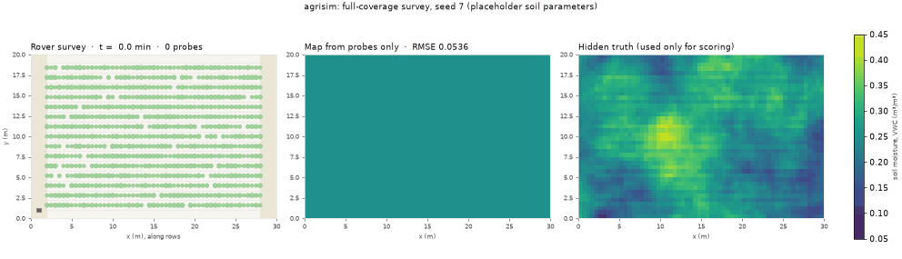
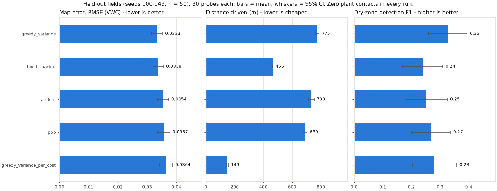
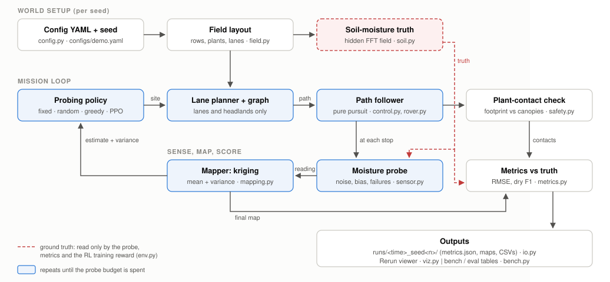
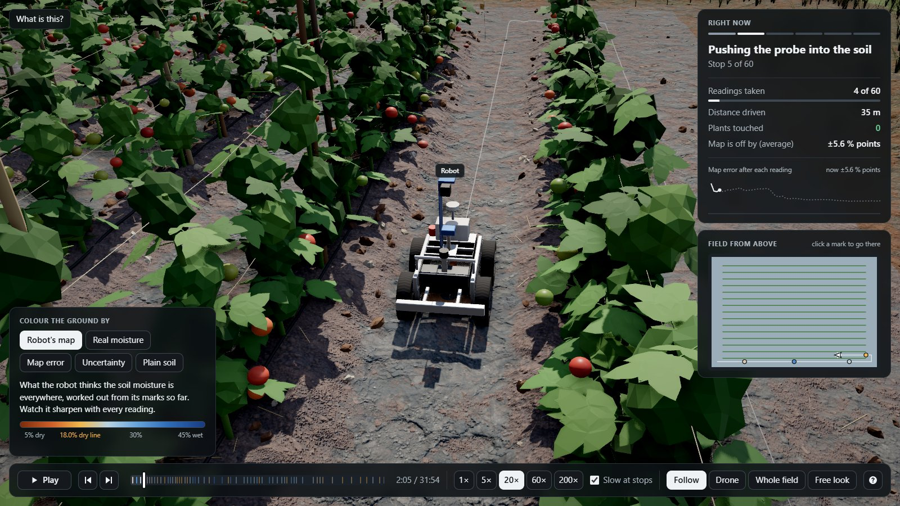
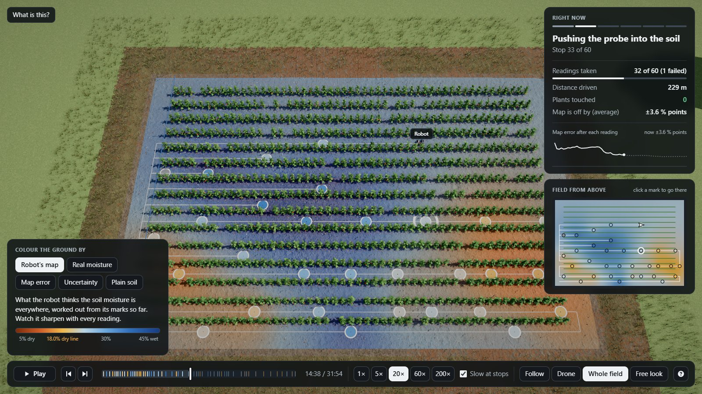
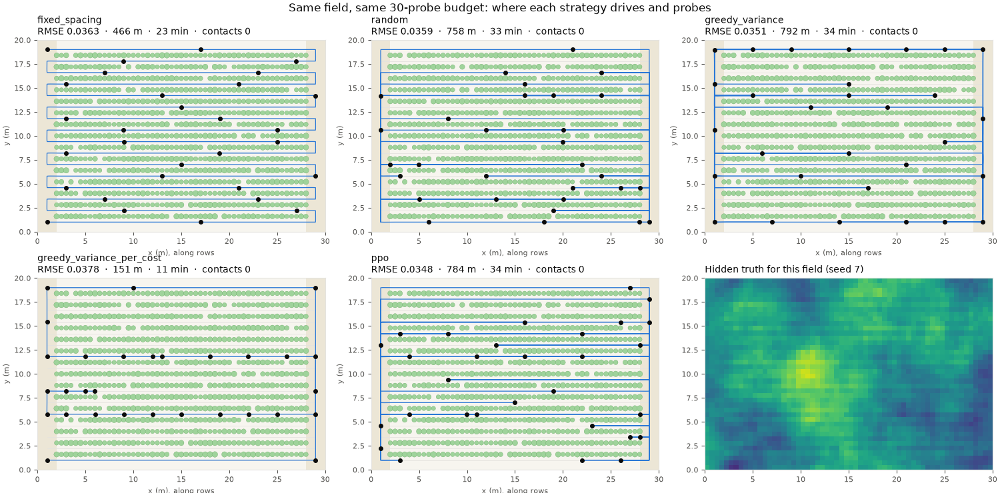
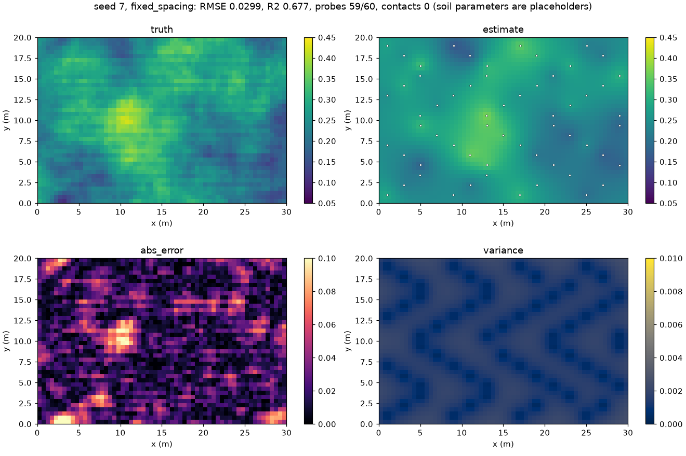
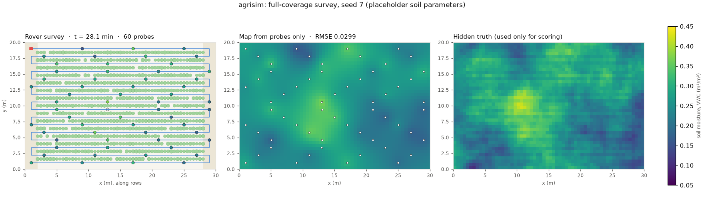

<div align="center">

# 🌱 agrisim: soil-moisture survey simulator

**A rover drives the lanes of a tomato field without touching a plant, probes the soil, and maps where the field is too dry.**

[](https://github.com/Auenchanters/SMC/actions/workflows/ci.yml)
[](https://github.com/Auenchanters/SMC/actions/workflows/benchmark.yml)
[](https://www.python.org/)
[](#quickstart)
[](tests/)
[](https://gymnasium.farama.org/)
[](https://rerun.io/)
[](LICENSE)

agrisim is a pure-Python simulator of a planted tomato field. A small differential-drive rover follows the lanes between plant rows. It stops to push a moisture probe into the soil, and turns a few dozen noisy readings into a **full-field moisture map plus an uncertainty map**. **agribench** pits our probing strategy against re-implemented published methods and a clairvoyant oracle, on fresh fields nobody has seen. The same world is also a **Gymnasium environment** for training a rover to decide *where* to probe.

> **On fresh fields nobody had seen, our strategy `planned_survey` scores 75.8 out of 100** (0 = random probing, 100 = a clairvoyant oracle). That is the best of the 12 real strategies, ahead of re-implementations of spatial-coverage sampling (Walvoort et al. 2010) at 60.7, MoistureMapper (CASE 2025) at 48.3 and greedy mutual information (Krause et al. 2008) at 30.6. An earlier run on different fresh fields gave 73.9. There were **zero plant contacts in 15,232 benchmark surveys**. Our own benchmark still rates us "below state of the art", because we do not yet win every metric, and we say so.



<sub>Real simulator output, seed 7. Higher-quality video: [docs/media/survey.mp4](docs/media/survey.mp4). Soil parameters are placeholders until calibrated.</sub>

**Demo video (3 min 9 s):** [docs/media/agrisim-demo.mp4](docs/media/agrisim-demo.mp4) shows the CLI, a run's outputs, the Rerun viewer, the 3D replay and the rover hardware figures.

</div>

---

## Table of contents

- [Why this exists](#why-this-exists)
- [Problems with existing products](#problems-with-existing-products)
- [How we outpace them](#how-we-outpace-them)
- [Results](#results)
- [What is new here](#what-is-new-here)
- [Project scope](#project-scope)
- [Where we can improve](#where-we-can-improve)
- [Future scope](#future-scope)
- [How it works](#how-it-works)
- [Architecture](#architecture)
- [3D replay](#3d-replay)
- [Screenshots](#screenshots)
- [Quickstart](#quickstart)
- [What a run produces](#what-a-run-produces)
- [Testing](#testing)
- [Regenerating the images and video](#regenerating-the-images-and-video)
- [Optional: NVIDIA GPU](#optional-nvidia-gpu)
- [Project structure](#project-structure)
- [Handover](#handover)
- [License](#license)

---

## Why this exists

Farmers usually water a whole field the same way, and dry patches show up only once the plants suffer. A soil-moisture survey fixes that, but a probe reads one spot at a time and each insertion takes 10 to 30 seconds. This project answers three questions in simulation, before any hardware is bought:

1. **Can a small rover cover a planted field without touching a single plant?** It may only drive the lanes between rows and turn in the headlands at the field edges.
2. **How few probes are enough to map the whole field, and how sure is the map?** Every map comes with its own uncertainty.
3. **Does choosing probe spots adaptively beat a plain evenly-spaced survey?** It is tested against published methods, on the same fields, with the same probe budget and the same deadline.

This is **Layer A** of the AgriRover project (MSRIT, first-year AI & DS team): pure Python, no ROS and no 3D engine, so it runs headless on any laptop. The idea of a scouting rover is not new (see [context.md §4](context.md)). Our value is doing these three things carefully and reporting the results honestly.

## Problems with existing products

We surveyed commercial products and published research robots on 16 and 17 October 2026. The full survey, with sources, is in [research.md](research.md) §3 to §5. No product we found maps soil moisture at sub-metre resolution by probing between the rows of a standing crop. Each existing approach leaves a gap:

| Approach | Examples | What it gives | The issue in a planted row crop |
|---|---|---|---|
| Fixed in-ground probes | CropX, Sentek, Soil Scout, Fasal | Moisture over time at a few fixed points | One point per zone. Several units in one field rarely agree, and one probe cannot represent a whole irrigation zone. |
| Handheld meters | Stenon FarmLab | A reading wherever a person walks | A person walks to every point, and there is no planning and no map uncertainty. An independent 2025 study found its chemical readings not ready for precision nutrient management. |
| Satellite | Planet Soil Water Content | 20 m to 1 km pixels | Far coarser than 1.2 m crop rows, and the top layer of soil only |
| Cosmic-ray neutron sensors | CRNS, also on a rover (Pulido Fentanes et al.) | One value over a 130 to 240 m radius | Cannot find a single clogged drip emitter |
| Tractor-pulled conductivity | Veris iScan | Swaths of electrical conductivity | A proxy that needs calibration, and a tractor cannot drive a standing row crop |
| Soil-coring robots | Rogo SmartCore | Cores for lab nutrient tests | Measures nutrients, not moisture. Lab turnaround, pre-planned grids, and a machine the size of a skid steer. |
| Under-canopy scouting robots | EarthSense TerraSentia, VineScout | Plant traits, canopy temperature | No soil moisture (TerraSentia). Water status is only estimated indirectly, with R² 0.42 to 0.57 (VineScout). |

Research robots that push a probe into the soil exist, but all are recent and each leaves a gap:

| Work | The gap |
|---|---|
| MoistureMapper (IEEE CASE 2025) | Plans in open space (straight-line distance). Its simulation headline is the map's own variance, not error against the truth. The field test was one 10 × 10 m grass plot. |
| AgriOne (IROS 2024 workshop) | Visits preset waypoints, and publishes no accuracy numbers |
| Langenscheidt et al. (J. Field Robotics) | 75.6% insertion success over 41 operations, with no mapping or planning |
| Pulido Fentanes et al. (J. Field Robotics 2020) | The robot drives freely. Constraints from soil beds and rows are listed as future work. |
| Nguyen et al. (ICRA 2025 workshop) | About 10 minutes per sample, but it does not address where to sample |

Benchmarks have the same gap. The 2024 survey of informative path planning (Popović et al., RAS 179) names the lack of shared simulators, metrics and benchmarks as a key open problem. The one agricultural benchmark we found, Waterberry Farms, lets robots move freely, with no lanes, no plants and no probe cost.

**Economics.** Hardware-heavy farm robots have failed on unit economics: Mineral (Alphabet X) shut down in July 2024, and Small Robot Company was wound up in February 2024. That is why this project proves the value in simulation first.

## How we outpace them

**On design**, compared with the closest published systems ([research.md §5.1](research.md)):

| | agrisim | MoistureMapper | Pulido Fentanes | AgriOne | RAPID (vineyards) | CAtNIPP |
|---|:---:|:---:|:---:|:---:|:---:|:---:|
| Travel restricted to the lanes between rows | **✅** | ❌ | ❌ | ? | ✅ | ❌ |
| Plant contact measured, and it must be zero | **✅** | ❌ | ❌ | ❌ | ❌ | ❌ |
| Map scored against the truth, not its own variance | **✅** | partly | ✅ | ❌ | n/a | ? |
| Map uncertainty checked for calibration | **✅** | ❌ | ? | ❌ | n/a | ? |
| Soil changes during the mission (rain, drying) | **✅** | ❌ | ❌ | ❌ | ❌ | ❌ |
| Plans to a mission deadline | **✅** | ❌ | ❌ | ❌ | ✅ | ✅ |
| Probes for the farmer's decision (too dry or not) | **✅** | ❌ | ❌ | ❌ | ❌ | ❌ |
| Open, deterministic benchmark with unseen fields | **✅** | ❌ | ❌ | ❌ | ❌ | code only |
| Real robot or real field data | ❌ | ✅ | ✅ | ✅ | ✅ | ❌ |

**On measured results.** Inside agribench we re-implemented the competitors' methods and ran them on the same fields, with the same probe, mapper, budget and deadline. Our entry beats each of them overall:

agribench scores run from 0 (random) to 100 (oracle). Each run used its own fresh fields:

| Strategy | Source | Latest run | Earlier run |
|---|---|---|---|
| **planned_survey (our entry)** | this project | **75.8** [95% CI 70.2, 81.1] | **73.9** [69.9, 79.1] |
| spatial_coverage | Walvoort, Brus and de Gruijter, Computers & Geosciences 2010 | 60.7 | 58.0 |
| fixed_spacing (lawnmower) | the standard baseline | 53.8 | 55.1 |
| moisturemapper_a2 | MoistureMapper, IEEE CASE 2025 | 48.3 | 45.3 |
| moisturemapper_a1 | MoistureMapper, IEEE CASE 2025 | 44.7 | 48.8 |
| greedy_variance | Pulido Fentanes et al., JFR 2020 | 37.8 | 32.1 |
| mi_greedy | Krause, Singh and Guestrin, JMLR 2008 | 30.6 | 25.8 |
| dov | Roberts-Elliott, Das and Cielniak, Robotics 2025 | −116 | −116 |

On the farmer's decision (dry-zone F1), our entry beats **every** baseline in 5 of the 8 tasks in the latest run, and in 7 of 8 in the earlier one. These are statistically significant wins, field by field, with one-sided Wilcoxon tests and Holm correction. In two more tasks the latest run falls only just short (Holm p 0.06 and 0.09).

<sub>Honest scope of this claim: these are our re-implementations, run in our simulator, not the original authors' robots in their fields. The DOV bid formula is unverified, so we call it "DOV-style". Every world number is a placeholder until calibrated.</sub>

## Results

### agribench: the strict benchmark

agribench (`agrisim suite`) has 8 frozen tasks:
- the demo field at two budgets;
- rover v2's slow 29 s probe;
- a rain shower;
- an afternoon of drying;
- patchy soil;
- a bigger field;
- a harsh world, where dry soil makes probes fail or read low and positions are off by 0.3 m.

Each task has a deadline, so driving costs probes. Gates are decided on **fresh fields nobody has seen**, so nobody can tune to them: CI draws them from a hash of the commit, and a local run from a random key. Scores are compared field by field against the competition. The benchmark is designed to stay red until our entry is genuinely near the oracle. Protocol, rules and sources: [benchmarks/README.md](benchmarks/README.md).

Latest full run (17 October 2026). It ran on a fresh clone of `main` from GitHub (commit `a158688`), with fields drawn from that commit: 15,232 surveys, 0 crashes, 0 plant contacts, 39 minutes on 8 workers.

| Rank | Strategy | Score |
|---|---|---|
| ref. | oracle_rmse (knows the truth) | 98.6 |
| **1** | **planned_survey (our entry)** | **75.8** [95% CI 70.2, 81.1] |
| ref. | oracle_dry (knows the truth) | 65.2 |
| 2 | spatial_coverage | 60.7 |
| 3 | fixed_spacing | 53.8 |
| 4 | fixed_plus_recheck (ours) | 53.7 |
| 5 | moisturemapper_a2 | 48.3 |
| 6 | moisturemapper_a1 | 44.7 |
| 7 | greedy_variance (our first entry) | 37.8 |
| 8 | recheck (ours) | 35.8 |
| 9 | mi_greedy | 30.6 |
| 10 | greedy_variance_per_cost (ours) | 15.9 |
| 11 | random | 0.0 |
| 12 | dov | −116 |

Our entry per task (normalised score with 95% CI, 64 fresh fields per task). **Bold** means it beats every baseline:

| Task | Map error (RMSE) | Map + uncertainty (CRPS) | Dry-zone F1 | Probes by deadline | Mission |
|---|---|---|---|---|---|
| demo_b30 | 55.8 [44.6, 66.8] | 106 [82.2, 137] | 79.4 [56.0, 111] | 30 of 30 | 17 min |
| demo_b60 | 70.8 [60.8, 82.3] | 106 [90.1, 129] | **115** [97.7, 137] | 60 of 60 | 30 min |
| v2_b30 | 46.6 [35.9, 55.9] | 92.9 [75.1, 115] | 76.8 [50.2, 111] | 30 of 30 | 27 min |
| rain_b60 | 47.7 [37.2, 57.9] | 67.7 [52.8, 84.8] | **70.1** [49.3, 89.6] | 60 of 60 | 44 min |
| drying_b60 | 70.5 [63.7, 77.8] | 102 [89.4, 116] | **87.2** [78.4, 95.0] | 60 of 60 | 30 min |
| rough_b60 | 49.5 [37.4, 60.7] | 76.9 [58.4, 95.3] | **49.2** [27.7, 77.4] | 60 of 60 | 30 min |
| large_b60 | 62.4 [51.6, 73.2] | 97.2 [78.3, 118] | **94.8** [75.2, 119] | 60 of 60 | 43 min |
| harsh_b60 | 53.1 [34.6, 69.1] | 107 [77.1, 152] | 59.7 [42.0, 76.7] | 60 of 60 | 28 min |

What this says:
- **The result holds on new fields.** The earlier full run (commit `cca381b`) used a different set of fresh fields and scored 73.9 [69.9, 79.1]. The two intervals overlap, and our entry was the best real strategy both times. The number of significant per-task wins moves between runs (8 of 24 earlier, 5 of 24 now). That is what 64 new fields per task do to a close comparison, and it is why the gates never reuse fields.
- **Probing for the dry threshold is what moves the score.** The coverage route alone ties spatial coverage. The last fifth of the budget, aimed at cells whose dry/not-dry call is in doubt, lifts dry-zone F1 above every baseline.
- **Every probe is taken before the deadline on every task.** In the rain task the rover waits out the shower instead of probing soil the rain is about to change. In the earlier run that also won on map error; in this run it is close but not significant.
- **Against global accuracy levels**, the map's unbiased RMSE (ubRMSE) is within the SMAP satellite mission requirement (0.04) on all 8 tasks in both runs. RMSE reaches the factory-calibrated probe class (0.03) on `demo_b60` and `drying_b60`.
- **Still below state of the art.** On soil that does not change, map error ties the coverage designs. The evidence says this is close to the honest limit of the v1 fields (see [Where we can improve](#where-we-can-improve)).

Every benchmark run also writes `brief.md`, a ready-made task for the next person or coding agent: what to fix first, how close each gate is, and the rules for testing a change. That closes an improvement loop ([benchmarks/README.md §7](benchmarks/README.md)). Run it:

```powershell
uv run agrisim suite --tier quick --workers 8
```

### Earlier results: held-out evaluation

These numbers come from `agrisim eval` (held-out fields, seeds 100 to 149, budget 30 probes, no deadline), measured before agribench existed. Transcripts are in [EXECPLAN.md, *Artifacts and Notes*](EXECPLAN.md#artifacts-and-notes).



| Strategy | Map error (RMSE, VWC) | R² | Dry-zone F1 | Distance | Mission time | Plant contacts |
|---|---|---|---|---|---|---|
| **greedy_variance** | **0.0333 ± 0.0019** | **0.55** | **0.33** | 775 m | 33 min | 0 |
| fixed_spacing (full coverage) | 0.0338 ± 0.0018 | 0.54 | 0.24 | 466 m | 23 min | 0 |
| random | 0.0354 ± 0.0019 | 0.50 | 0.25 | 733 m | 33 min | 0 |
| ppo (MaskablePPO, 200k steps) | 0.0357 ± 0.0020 | 0.49 | 0.27 | 689 m | 31 min | 0 |
| greedy_variance_per_cost | 0.0364 ± 0.0023 | 0.46 | 0.28 | **149 m** | **11 min** | 0 |

<sub>Mean ± 95% Student-t interval over 50 held-out fields. A single field-average value would score RMSE ≈ 0.052 with the same readings. Dry-zone F1 is undefined on fields where a map predicts no dry cell (8 to 17 fields per strategy); those are left out of its mean.</sub>

- **Safety holds.** No strategy ever touched a plant.
- **The map is honest about its uncertainty.** About 96% of cells fall inside the map's own 95% band (target 95%).
- **Variance-driven probing ties even spacing.** That is expected in theory: with fixed model settings, the map's uncertainty depends only on where readings were taken, not on what they read ([research.md §7.3](research.md)). It is why our entry probes for the dry/not-dry decision instead.
- **RL did not win.** The first learned policy behaves close to random. Likely causes are in the [ExecPlan](EXECPLAN.md#surprises--discoveries).

### Weather and going back to check

The soil can change during a mission: rain soaks in (more in some spots than others), and sun and plants dry it out. The probe also sometimes misreads, because of poor soil contact. Two strategies let the robot go back to a spot it doubts: `recheck` and `fixed_plus_recheck`. The robot knows how much it rained, from its rain gauge, but not how much soaked in at each spot.

Scenario `configs/scenarios/rain_shower.yaml` (a 10-minute downpour starting 10 minutes in, 1 misread in 20), 30 fields, budget 60:

| Strategy | Map error (RMSE) | Distance | Mission time |
|---|---|---|---|
| recheck | 0.0276 ± 0.0020 | 1501 m | 65 min |
| greedy_variance | 0.0280 ± 0.0016 | 1502 m | 66 min |
| fixed_plus_recheck | 0.0300 ± 0.0014 | 728 m | 37 min |
| fixed_spacing | 0.0308 ± 0.0012 | 466 m | 28 min |

Going back helps a little: 2 to 3% better, on 18 of the 30 fields. That is not conclusive.

```powershell
uv run agrisim run --config configs/scenarios/rain_shower.yaml --seed 7 --policy fixed_plus_recheck --view
```

## What is new here

**Built and tested:**

1. **Probing for the farmer's decision, not for the map's variance.** `planned_survey` spends its last probes where a reading most reduces the expected number of cells on the wrong side of the dry threshold. This expected misclassification reduction is computed in closed form with Gauss-Hermite quadrature. Unlike variance, it depends on the values read, so the probing is genuinely adaptive ([policies.py](src/agrisim/policies.py)).
2. **Plans that fit the deadline.** Coverage sites are chosen by k-means and routed with nearest neighbour plus 2-opt on the lane graph. The plan shrinks until driving plus probing fits the mission time.
3. **Waiting out the rain.** When rain is forecast before the deadline, the rover drives to its farthest planned site instead of probing soil the rain is about to change.
4. **Lane-only, plant-safe motion.** Paths use only lane and headland centrelines, the rover reverses instead of making a U-turn inside a lane, and every pose is checked against every nearby canopy. A plant contact fails the benchmark.
5. **A benchmark that is hard to game.**
   - Fresh fields come from a hash of the commit.
   - The worlds are frozen under a SHA-256 lock.
   - Statistics are paired, with Holm correction and interquartile-mean headlines.
   - A regression ratchet guards against slipping back.
   - A *truth-swap test* proves no strategy or mapper can see the hidden truth.
6. **An improvement loop.** Every benchmark run writes `brief.md`, the next agent's task. CI adds it to the job summary.
7. **Hardware designed from the physics.** In rover v2 ([hardware/rover-v2/](hardware/rover-v2/DESIGN.md)):
   - The probe sits in an open bay between the axles, the only place where the rover's whole weight resists the push (175 N usable, against a 106 N dry-crust estimate).
   - A rocker-differential chassis gives 150 mm clearance.
   - The probe cleans itself, escalating through levels on its own, so no person is needed.
8. **Reproducible on any laptop.**
   - Windows-native with no WSL, Docker or compiler.
   - The same config and seed give a byte-identical `metrics.json`.
   - Windows no longer throttles benchmark workers in the background.

**Innovations we can make next** (detail in [docs/FUTURE_SCOPE.md](docs/FUTURE_SCOPE.md)):

- **A per-zone irrigation plan and a water-regret score.** Turn the map into litres per drip zone, which is what a farmer or an irrigation controller like FasalJet acts on.
- **Failed insertions as information.** A probe that fails in hard soil says "drier than X". Treated as a censored reading, it could win the harsh task.
- **Side reach plus row-aware kriging.** Lane-centre readings cannot tell probe bias apart from the wetter drip line under the rows ([research.md §7.1](research.md)). A reach of 0.30 m would see half of it, against about 2% with the current ±60 mm rail.
- **Lookahead planning.** It matters more as probes get slower: 29 s for rover v2, about 10 minutes for an onboard lab.

## Project scope

| In scope (this repository) | Out of scope (for now) |
|---|---|
| Simulating a planted tomato field: rows, plants, lanes, headlands, hidden soil moisture, weather during a mission | ROS, Gazebo, Unity, Isaac or other 3D-engine code (Phase 2, a separate plan) |
| Rover kinematics, lane-only path planning and following, plant-contact checks | Building the physical rover. v2 is a complete design, not yet built ([hardware/](hardware/)). |
| Probe model: noise, bias, failures, hard soil, misreads | Cameras and disease detection (Phase 3) |
| Kriging map plus uncertainty, scored against the truth | Real field data. Every number is a placeholder until calibrated. |
| Probing strategies, the published baselines and a learned policy (Gymnasium + MaskablePPO) | Web dashboards and cloud services |
| agribench: frozen tasks, fresh fields, paired statistics, CI on every push | Crops other than tomato, until someone has their numbers |
| The 3D replay and the Rerun live view | Irrigation control. The map is the output today; a zone plan is future scope. |

## Where we can improve

Our known weaknesses, with evidence. The full list, with severity and fixes, is in [research.md §6](research.md).

- **No real data yet (the biggest gap).** Every soil and probe number is a placeholder: moisture levels, noise, patch sizes, row spacing, the "dry" threshold. The results compare strategies *inside the simulator*; they are not field accuracy. Every research robot we compare against has a real robot or real data.
- **Map error ties the coverage designs on soil that does not change.** Two noise draws of the same probe layout already differ by 7 to 15% per field, and an optimised layout lowers kriging variance only 0.3 to 1.9% below k-means. A significant win needs information the v1 fields do not offer to a strategy that cannot see the truth.
- **Dry zones under hard soil are not won** (`harsh_b60`). The probe reads 0.02 wet, so probes at the edge of a dry zone read wet, and half the probes in dry soil fail. Retrying, and treating failures as likely dry, made no measurable difference so far.
- **Lane-centre probes cannot see the drip line under the rows.** In the demo config, the placeholder probe bias happens to cancel most of that unseen difference ([research.md §7.1](research.md)).
- **The learned policy loses to simple baselines.** Its global network cannot easily point at one specific site among 464, and 200k training steps are few. A per-site action head is untested.
- **The weather model flatters the robot.** The robot's own rain correction is nearly perfect, and there is no irrigation during a mission yet.
- **One crop and one field geometry.** Generalisation across row spacings and field sizes is only partly tested (the large-field task).
- **Positioning error is independent per reading.** Real GNSS error without RTK drifts over time.

## Future scope

The detailed plan, with evidence and "done when" criteria for each item, is in **[docs/FUTURE_SCOPE.md](docs/FUTURE_SCOPE.md)**. In short:

1. **Win the remaining gates:** censored readings for hard soil, row-aware mapping, lookahead under a time budget.
2. **Ground the simulator in real data:** calibrate on the public Cook Agronomy Farm network, then on one drip-irrigated tomato plot of our own, then add a real-data track to agribench.
3. **Close the loop to the farmer:** a per-zone irrigation plan, a water-regret metric, and an export an irrigation controller can read.
4. **More realism:** side probe reach co-designed with the rover rail, drifting GNSS error, a space-time map, blocked lanes, irrigation, several depths.
5. **Learning, optionally:** a per-site policy and a faster environment. A negative result is still a result.
6. **agribench v2:** a non-myopic oracle, zone metrics, a compute-time gate.
7. **A test bench for field robots:** a scenario library, crop profiles, robots as plug-ins, several robots, then Gazebo and ROS 2 (Phase 2).
8. **Hardware and product:** build and bench-test rover v2, then offer surveys as a service. Then cameras and disease detection (Phase 3).
9. **A research paper** on decision-focused, lane-constrained probing ([research.md §9](research.md)).

## How it works

Per mission, from one config file and one integer seed:

1. **Build a field.** Rows, plants with random canopy sizes and gaps, lanes and headlands ([field.py](src/agrisim/field.py)). Config validation refuses a rover that would not fit in a lane or could not turn in the headland, and the error message states the numbers.
2. **Hide a believable moisture field.** It is a spatially correlated Gaussian random field made with FFT ([soil.py](src/agrisim/soil.py)). On top come wetter drip-line stripes along the rows, random dry patches (a clogged emitter) and wet patches (a leak). Only the probe, the metrics and the RL reward may read it. With a `weather:` section it changes during the mission: rain soaks in unevenly, while sun and plants dry it ([weather.py](src/agrisim/weather.py)).
3. **Choose where to probe** ([policies.py](src/agrisim/policies.py)):
   - our entry `planned_survey`;
   - fixed spacing, random, greedy max-variance, variance per travel cost;
   - recheck, which also goes back to readings it doubts;
   - the published baselines;
   - a trained PPO policy.
4. **Drive there safely.** Paths use only lane and headland centrelines ([planning.py](src/agrisim/planning.py)). The rover turns in place in headlands, follows lanes with pure pursuit, and **reverses** instead of making a U-turn inside a lane ([control.py](src/agrisim/control.py)). Every pose is checked against every nearby canopy ([safety.py](src/agrisim/safety.py)).
5. **Probe.** The reading is the footprint average plus bias, Gaussian noise and quantisation. Probes sometimes fail, more often in hard dry soil when that is switched on ([sensor.py](src/agrisim/sensor.py)).
6. **Map.** Ordinary kriging with a fitted variogram gives a mean map and a variance map. With too few readings it falls back to the field average; it never crashes ([mapping.py](src/agrisim/mapping.py)).
7. **Score.** The metrics are ([metrics.py](src/agrisim/metrics.py)):
   - RMSE, MAE and R²;
   - CRPS;
   - dry-cell precision, recall and F1;
   - uncertainty calibration;
   - distance, time and lane coverage;
   - plant contacts.

The same config and seed always give a byte-identical `metrics.json`.

## Architecture



Everything is driven by one YAML file ([configs/demo.yaml](configs/demo.yaml)). Every physical number in it is marked `# PLACEHOLDER: calibrate`. Scenarios in [configs/scenarios/](configs/scenarios/) start from it with `extends:` and change only what differs, for example adding a rain shower. The benchmark's frozen worlds are in [benchmarks/v1/worlds/](benchmarks/v1/worlds/).

## 3D replay

Add `--view` to any run to replay it in 3D in your browser:
- The rover, built from the hardware design's dimensions, drives between staked tomato rows, parks, and pushes its probe into the soil.
- Every reading leaves a coloured mark, and the moisture map fills in on the ground.
- A panel says in plain words what is happening.
- Buttons switch the ground colour between the robot's map, the real moisture, the map error and the uncertainty.

It works offline (three.js is bundled) and needs no install beyond `uv sync`.

```powershell
uv run agrisim run --config configs/demo.yaml --seed 7 --view
```

| | |
|:---:|:---:|
|  **Following the robot.** It has parked and is pushing the probe into the soil. |  **The whole field.** Orange = too dry, blue = wet; each round mark is a reading. |

Reopen a run later with `uv run agrisim view runs\<folder>`. Press `?` in the page for a guide.

## Screenshots

| | |
|:---:|:---:|
|  **Same field, same budget.** Where each strategy drives (blue) and probes (black). |  **One run's output.** Truth, estimate, absolute error and kriging variance, all on fixed colour scales. |



**Live view:** `--rerun` opens the [Rerun](https://rerun.io/) viewer. It shows:
- the field and the moving rover;
- probes coloured by reading;
- the four maps, updating after each probe;
- the average map error over time.

A "How to read this" panel explains each view. Drag the time bar to replay a mission.

## Quickstart

Windows PowerShell (Linux and macOS use the same commands). You need [uv](https://docs.astral.sh/uv/) and git. You do not need WSL, Docker or a compiler.

```powershell
powershell -ExecutionPolicy ByPass -c "irm https://astral.sh/uv/install.ps1 | iex"
git clone https://github.com/Auenchanters/SMC.git
cd SMC
uv sync
git config core.hooksPath .githooks
```

`uv sync` installs Python 3.13 and every pinned dependency into `.venv`. The last line turns on the repository's git hooks (see [CLAUDE.md](CLAUDE.md)).

**1. One survey** (add `--view` for the 3D replay, or `--rerun` for the Rerun viewer):

```powershell
uv run agrisim run --config configs/demo.yaml --seed 7
```

```text
run folder     runs\20261013T173847Z_seed7
policy         fixed_spacing
RMSE / MAE     0.0299 / 0.0230 m3/m3   R2 0.677
dry cells      precision 0.870  recall 0.116  F1 0.205  (truth dry fraction 0.072)
calibration95  0.979
probes         59 valid / 60 used
path / time    465.7 m / 1685 s
lane coverage  1.000
plant contacts 0
```

Other options:
- `--policy planned_survey|random|greedy_variance|greedy_variance_per_cost|spatial_coverage|moisturemapper_a1`, and others;
- `--budget 30`;
- the shipped learned policy, with `--policy ppo --model models/ppo_v1/model.zip`.

**2. Compare strategies** on 50 random fields with the same probe budget (about 40 s with 4 workers):

```powershell
uv run agrisim bench --config configs/demo.yaml --seeds 0-49 --budget 30 --workers 4 --strategies fixed_spacing,random,greedy_variance,greedy_variance_per_cost
```

Without `--strategies`, it runs every strategy, which takes several minutes.

**3. Run the benchmark.** On 8 workers, the quick tier takes about 4 minutes and the full tier about 40:

```powershell
uv run agrisim suite --tier quick --workers 8
```

**4. Train and evaluate a learned policy.** Training takes about 25 min on a 16-thread laptop CPU. Evaluation runs every baseline on the same 50 held-out fields:

```powershell
uv run agrisim train --config configs/demo.yaml --timesteps 200000 --seed 0 --n-envs 6 --out runs/ppo_v1
uv run agrisim eval --model runs/ppo_v1/model.zip --config configs/demo.yaml --seeds 100-149 --budget 30 --workers 6
```

The model behind the results table ships in [models/ppo_v1/](models/ppo_v1/), so you can run `eval` without training first. Training draws field seeds of 1000 and above, and `eval` refuses seeds of 1000 or more, so evaluation fields are always unseen.

There is also a ready-made demo: [scripts/demo.ps1](scripts/demo.ps1) (Windows) or [scripts/demo.sh](scripts/demo.sh).

## What a run produces

Each run writes a new folder `runs/<UTC time>_seed<seed>/`, for example `runs/20261013T173847Z_seed7/`. The name has no `:`, so it is valid on Windows, and earlier runs are never overwritten.

| File | Contents |
|---|---|
| `config.yaml` | The exact configuration used |
| `metrics.json` | Every metric below, plus the hidden field's correlation length and its dry and wet patches |
| `truth.npy` / `estimate.npy` / `variance.npy` | Truth, estimate and kriging variance on the 0.5 m output grid (rows = y, columns = x) |
| `probes.csv` | Every probe: time, position, reading, whether it worked |
| `path.csv` | The rover pose every 0.05 s |
| `maps.png` | Truth, estimate, error and variance with fixed colour scales |
| `recording.rrd` | Rerun recording (only with `--rerun`); reopen it with `uv run rerun <file>` |
| `scene.json` | Data for the 3D replay (only with `--view`); reopen it with `uv run agrisim view <folder>` |

`bench` and `eval` write `runs/bench_<time>/` or `runs/eval_<time>/`, with `results.csv` (one row per strategy and seed) and `summary.md` (mean and 95% interval per strategy). `suite` writes `runs/suite_<time>/`, with `report.md`, `report.json`, `rows.csv` and `brief.md`.

<details>
<summary><b>What every metric means</b></summary>

Soil moisture is volumetric water content (VWC): cubic metres of water per cubic metre of soil, so 0.25 means 25%.

| Metric | Meaning | Better |
|---|---|---|
| `rmse`, `mae` | Typical error of the map over every 0.5 m cell (root-mean-square and mean absolute) | Lower |
| `r2` | Share of the field's moisture variation the map explains (1 = perfect, 0 = no better than one average) | Higher |
| `crps` | (suite) The map and its uncertainty together, as a proper scoring rule, so a wide band cannot buy a good score | Lower |
| `ubrmse` | (suite) RMSE with the overall bias removed, the SMAP / ISMN convention | Lower |
| `dry_precision` | Of the cells the map calls dry (below `dry_threshold`), the fraction that really are. Empty if the map calls nothing dry | Higher |
| `dry_recall` | Of the truly dry cells, the fraction the map found | Higher |
| `dry_f1` | The balance of the two above. In the suite it is defined on every field. | Higher |
| `calibration_95` | Fraction of cells whose truth lies inside the map's own 95% band | ≈ 0.95 |
| `rmse_global_mean`, `rmse_idw` | (bench) Error if the same readings were mapped by one average or by inverse-distance weighting | Comparison |
| `probes_used`, `valid_probes` | Probes taken, and how many returned a value (probes can fail) | |
| `path_length_m`, `mission_time_s` | Distance driven; total time including each probe insertion | Lower |
| `lane_coverage` | Fraction of all lane length driven | 1.0 for a full survey |
| `plant_contacts` | Times the rover body overlapped a canopy | **Must be 0** |

</details>

## Testing

```powershell
uv run ruff check .
uv run ruff format --check .
uv run mypy src
uv run pytest -q
.\scripts\check_licenses.ps1
```

There are 131 tests. They take about 2 minutes and need no network. They cover:
- geometry validation;
- field determinism;
- the soil generator's correlation structure, checked against the exponential covariance;
- probe bias, noise and failure rates;
- **zero plant contacts over a full survey on 20 random fields**;
- shortest paths that never cross a row;
- in-lane reversing;
- kriging beating the field average;
- hand-checked dry-cell metrics;
- byte-identical repeat runs;
- the Rerun recording;
- serial and parallel bench giving identical results;
- clean CLI errors for bad configs and policies;
- Gymnasium's `check_env`;
- an end-to-end train-and-eval smoke test.

For agribench they cover:
- CRPS against its definition;
- the scoring and the statistics;
- the hash lock and the regression ratchet;
- the improvement brief;
- **a truth-swap test showing no strategy or mapper can see the hidden truth**. The oracle's readings do change, which shows the test can detect a leak.

For our entry `planned_survey` they cover:
- its 2-opt route;
- fitting the plan to a deadline;
- waiting out forecast rain;
- the dry-threshold gain peaking at a dry patch's edge.

They also check that the Windows worker speed-up never fails a run.

`mypy` runs in strict mode. The licence gate fails on any GPL, AGPL or LGPL package. CI runs all of this on **windows-latest and ubuntu-latest** on every push. The agribench quick tier runs as a separate job on every push, and the full tier nightly ([benchmark.yml](.github/workflows/benchmark.yml)).

**Fresh-clone check (17 October 2026).** A clean clone of `main` (`a158688`) from GitHub, with a fresh virtual environment (`uv sync --locked`), on the team's Windows 11 laptop:

| Check | Result |
|---|---|
| ruff, ruff format, mypy strict (Windows and `--platform linux`), licence gate, benchmark lock | all pass |
| pytest | 131 passed in 111 s |
| Smoke run, seed 7 | RMSE 0.0299, 59 of 60 probes, 465.7 m, 0 contacts, as [HANDOVER.md](HANDOVER.md) expects |
| `agrisim bench`, 4 strategies, seeds 0 to 49 | completes, 0 contacts |
| agribench quick tier | hard and regression gates pass; 63.8 [49.2, 77.5] on 16 fresh fields per task; 4 min |
| agribench full tier | hard and regression gates pass; 75.8 [70.2, 81.1]; 0 contacts in 15,232 surveys; 39 min |
| GitHub Actions on the same commit | CI (Windows, Ubuntu, hardware) and Benchmark both green |

## Regenerating the images and video

Everything in [docs/img](docs/img) and [docs/media](docs/media) is real simulator output, made by one script:

```powershell
uv run python scripts/make_media.py --model runs/ppo_v1/model.zip
```

It re-runs seed 7 and writes:
- `survey.gif`;
- `survey.mp4` (needs `ffmpeg` on PATH);
- `hero.png`, `maps.png` and `strategies.png`.

It draws `results.png` from the newest `runs/eval_*/results.csv`, or from a file you pass with `--results <file>`. Without `--model`, the PPO panel is skipped. It takes about 8 minutes, mostly frame rendering. [architecture.svg](docs/img/architecture.svg) is edited by hand.

## Optional: NVIDIA GPU

You don't need a GPU. The default PyTorch is the CPU build and the models are small. NVIDIA's CUDA libraries are free but not open source, so the CPU build is the fully open path. The simulator and the benchmark are CPU work (kriging and path planning); a GPU would not speed them up.

To try the RTX 3050 for training anyway (torch 2.14.1 publishes Windows CUDA 12.6 and 13.0 builds):

```powershell
uv pip install --reinstall torch==2.14.1 --index-url https://download.pytorch.org/whl/cu126
uv run --no-sync python -c "import torch; print(torch.cuda.is_available())"
```

After that, use `uv run --no-sync ...`, because a plain `uv run` or `uv sync` restores the CPU build. Also note that `agrisim train` pins `device="cpu"` in [env.py](src/agrisim/env.py). *Not yet verified on the team laptop.*

## Project structure

```
src/agrisim/
  config.py     pydantic models + geometry validation, load(path)
  field.py      rows, plants, lanes, headlands, candidate probe sites
  soil.py       hidden truth: FFT Gaussian random field + drip stripes + dry/wet patches
  weather.py    rain, evapotranspiration, drainage during a mission
  sensor.py     moisture probe: footprint mean, bias, noise, quantisation, failures, hard soil
  rover.py      differential-drive kinematics, footprint
  planning.py   boustrophedon full-coverage planner, closed-form lane graph
  control.py    turn-in-place + pure pursuit, reverse along lanes
  safety.py     rectangle-vs-canopy contact test (KD-tree, vectorised)
  mapping.py    Mapper protocol: GlobalMean, IDW, Kriging (PyKrige)
  metrics.py    map and run metrics, CRPS, the benchmark's clairvoyant oracle (may read the truth)
  policies.py   our entry planned_survey, fixed, random, greedy variance, recheck, published baselines
  sim.py        run_survey(): drive, probe, map, score
  env.py        Gymnasium env, MaskablePPO training, learned policy
  bench.py      multi-seed benchmark, 95% intervals, Markdown summary, full-speed workers
  suite.py      agribench: frozen tasks, fresh fields, normalised scores, paired tests, gates, brief
  viz.py        Rerun logging
  view3d.py     3D replay: scene.json and a local web server
  viewer3d/     the 3D replay page (three.js 0.186.1 bundled, MIT)
  io.py         Windows-safe run folders and outputs
  cli.py        agrisim run | bench | suite | gate | train | eval | view
configs/            demo.yaml (all placeholders, marked "PLACEHOLDER: calibrate") and scenarios/
benchmarks/         agribench: protocol (README.md), our entry (solution.yaml), frozen v1/ suite
scripts/            demo.ps1 / demo.sh, check_licenses.ps1 / .sh, make_media.py, demo_video/
tests/              pytest suite
docs/               README images and video, FUTURE_SCOPE.md
models/ppo_v1/      trained MaskablePPO policy + its held-out evaluation
hardware/rover-v2/  rover hardware design: model, calculations, drawings, anatomy figures, BOM (v1, superseded, in rover-v1/)
```

The planning documents:
- [context.md](context.md): verified research, licence and platform rules. It is the source of truth.
- [EXECPLAN.md](EXECPLAN.md): the milestone plan, with every decision, surprise and result.
- [research.md](research.md): competitors, papers, our flaws, and the work packages.
- [docs/FUTURE_SCOPE.md](docs/FUTURE_SCOPE.md): what to build next.
- [CLAUDE.md](CLAUDE.md): rules for the coding agent.

## Handover

Taking the project over? Start with [HANDOVER.md](HANDOVER.md). It has a step-by-step test plan, the expected results, and the known open items. If you are working on our agribench entry, start from the latest `runs/suite_*/brief.md`.

## License

[MIT](LICENSE) © 2026 Auenchanters
