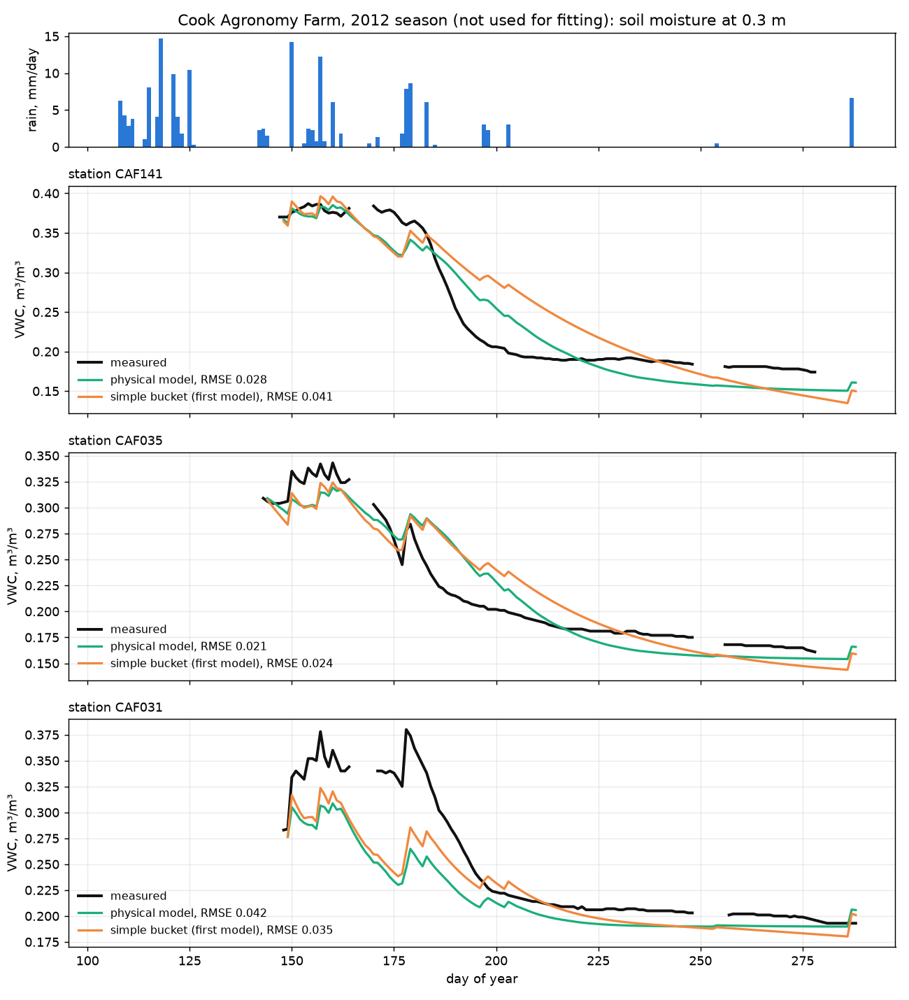
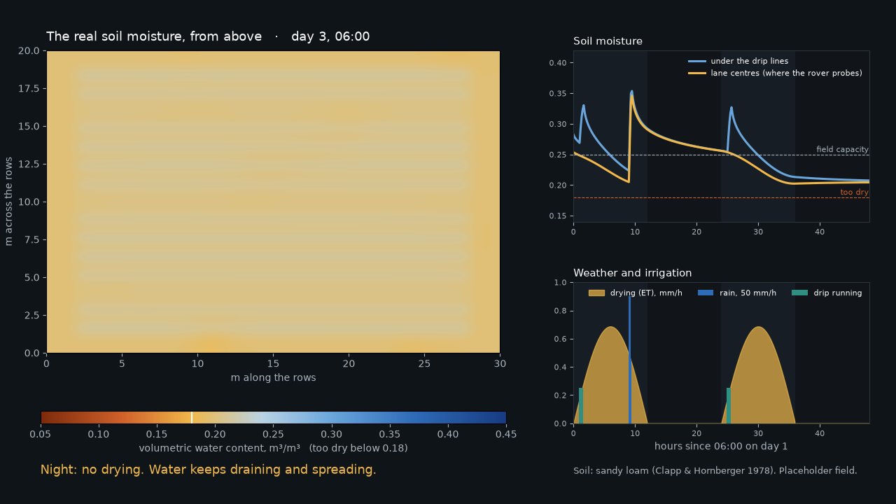

# Soil physics and its check against real data

agrisim now has two models of how the soil gains and loses water during a mission:

- **The bucket** (the first model, still the default and the one the frozen benchmark uses): rain adds water, a constant rate removes it, and anything above field capacity drains at a fixed share per hour.
- **The physical model** (new, opt-in with a `physical:` section under `weather:`): intake, drainage and drying each follow a published soil-physics law, with parameters from a published table of soil textures.

On real field data the physical model forecast a whole unseen season with a typical error of 0.028 m³/m³, against 0.037 for the bucket. It was better at 12 of 19 stations (paired Wilcoxon test, one-sided p = 0.005). Details and limits are below.

## 1. What the physical model does

Each step, for every cell of the soil grid (`weather.water_balance`):

| Process | Law | Source |
|---|---|---|
| **Intake** | Water soaks in up to a capacity of `Ks (1 + ψf (θs − θ) / depth)`. Dry soil takes water faster. The rest runs off, and so does anything above porosity. | Green and Ampt (1911), with the wetting-front suction of Rawls et al. (1983) |
| **Drainage** | Gravity flow at `K(θ) = Ks (θ / θs)^(2b+3)`, integrated exactly over the step, so it is stable for any step length. | Campbell (1974) |
| **Drying** | `Kc × ET0`, following the sun through the day, cut back once the soil is drier than the readily available water, and zero at the wilting point. | FAO-56 (Allen et al. 1998), eq. 84 |
| **Drip irrigation** | Each emitter's flow lands on a strip along its plant row. | Config: emitter flow, spacing, strip width |
| **Sideways spread** | Diffusion between neighbouring cells. | Config: one diffusivity |

Soil properties come from a texture class (`sand`, `sandy_loam`, `clay`, and 8 more): porosity, saturated conductivity `Ks`, air-entry suction and Campbell's `b`, the means of 1,845 soils in Clapp and Hornberger (1978, Table 2). Field capacity and wilting point follow from the retention curve at 33 kPa and 1,500 kPa. Any property can be overridden with a measured or fitted value.

The rover's own forecast of how its old readings have changed uses the same function with average intake. It leaves irrigation out, because it probes lane centres, outside the drip strips.

## 2. The data

The Cook Agronomy Farm sensor network (Pullman, Washington, USA): 42 stations in a 37 ha field, daily soil moisture at 0.3 m depth, with daily rain and air temperature, for 2011 and 2012 ([Gasch et al. 2015](https://doi.org/10.1016/j.spasta.2015.04.001)). The copy used ships with the R package GSIF ([data/cookfarm.rda](https://github.com/cran/GSIF/tree/master/data)). The script downloads it at run time; it is not stored in this repository.

Why this dataset: it is open, has both the weather and the soil response, covers two full seasons, and research.md already named it as the first calibration target (work package WP1a).

## 3. The test

`scripts/calibrate_cookfarm.py`:

1. Fits each model's parameters to each station's **2011** growing season (15 April to 15 October), by least squares.
2. Runs each fitted model through the **2012** season as a free-running forecast: it sees the first day's reading, then only rain and temperature for about 180 days.
3. Scores the forecast against the 2012 measurements. 2012 is never used for fitting.

Reference evapotranspiration comes from the station's daily temperatures (Hargreaves and Samani 1985). 19 of the 42 stations have at least 120 days of data in both seasons.

| Forecast error on the unseen 2012 season (RMSE, m³/m³) | Median | Mean | Middle half of stations |
|---|---|---|---|
| **Physical model** | **0.028** | 0.032 | 0.023 to 0.040 |
| Bucket (the first model) | 0.037 | 0.042 | 0.027 to 0.055 |
| No model (soil stays as on day 1) | 0.107 | 0.105 | 0.073 to 0.131 |

- The physical model is better at 12 of 19 stations; the paired difference is significant (Wilcoxon, one-sided p = 0.005).
- On the fitting season itself the errors are 0.012 (physical) and 0.015 (bucket).
- With **one** parameter set for the whole field instead of one per station, the two models are close: median 0.038 (physical) against 0.039 (bucket). Most of the physical model's advantage comes from fitting each station's soil.



The picture shows why. Real soil dries fast while it is wet and then levels off as the plants run short of water. The physical model levels off; the bucket keeps falling in a straight line.

## 4. What the data says about the field as a whole

- On a typical day the stations differ from each other by 0.034 m³/m³ (standard deviation). The demo config assumes 0.05, a placeholder.
- The spread is a little larger when the field is dry (0.032) than when it is wet (0.026).
- The stations are 72 m apart on average, so this dataset cannot say how moisture varies over the 1 to 30 m that matter inside a drip-irrigated plot. That still needs our own dense survey (WP1b).

## 5. Limits: read these before quoting the numbers

1. **Wrong crop, soil and climate for our target.** Cook Farm is rain-fed wheat on silt loam in a cool, dry-summer climate. Our target is drip-irrigated tomato on red sandy loam in Karnataka. The test supports the model's *form*. The fitted numbers describe that farm, not ours.
2. **Wrong depth.** The shallowest sensor is at 0.3 m. Our probe reads the top 6 to 10 cm, which wets and dries faster. The fitted layer depth hit the upper bound of the search (0.9 m), which means one layer is standing in for a deep root zone.
3. **Daily data.** The test cannot check what happens within an hour, which is the time scale of a survey. Intake limits and run-off during a cloudburst are untested.
4. **Neither model captures the crop's growth stage.** Both miss the timing of the fastest drying by a week or two at some stations.
5. **Drip irrigation and sideways spread are not tested at all.** No open dataset we could reach has them.
6. **Every number in the tomato scenarios is still a placeholder**, now with a named source: the texture table and FAO-56 crop values instead of round guesses.

## 6. What the physical model showed in simulation

Running a survey while the drip lines are on (`configs/scenarios/drip_irrigation.yaml`) makes a known weakness visible. The water lands on the strips along the plant rows, 0.6 m from the lane centres where the rover probes. The rows soak, the rover's readings do not change, and its map error rises: from 0.026 with the drip off to 0.037 with it on (RMSE, `planned_survey`, the same 12 fields, seeds 200 to 211; higher on all 12). Lane-centre probing cannot see drip irrigation. This is flaw 6 in research.md, now reproduced by the physics instead of assumed.

A two-day time-lapse of the hidden soil (`scripts/soil_timelapse.py`):



## 7. How to use it

```powershell
uv run agrisim run --config configs/scenarios/drip_irrigation.yaml --seed 7 --policy planned_survey --view
uv run agrisim run --config configs/scenarios/monsoon_shower.yaml --seed 7 --policy planned_survey --view
uv run python scripts/soil_timelapse.py --out runs/timelapse
uv run --with rdata --with pandas python scripts/calibrate_cookfarm.py --out runs/cookfarm
```

The frozen benchmark (`benchmarks/v1`) still uses the bucket, and its results are unchanged: 70 runs on its worlds were compared before and after, and all are identical. Putting the physical model into the benchmark would be a new benchmark version.

## 8. Next data to get

| Dataset | What it would add | Status |
|---|---|---|
| Our own tomato plot (WP1b): 100 to 150 handheld readings, lane-to-row transects, before and after a drip run | The only way to calibrate the drip strip, the top 10 cm and our soil | Needs field access |
| ISMN stations in India, or ISRO's soil moisture products | Local climate and soil at coarse scale | Not reachable from this workspace; needs a login |
| Tarrawarra (Australia): 500 to 2,000 TDR points per survey | Dense spatial pattern at 10 m | Listed in research.md; not fetched |

## Sources

- Clapp, R. B. and Hornberger, G. M. (1978). Empirical equations for some soil hydraulic properties. *Water Resources Research* 14(4). Table as reproduced by [CSDMS](https://csdms.colorado.edu/wiki/Model_help:TopoFlow-Soil_Properties_Page).
- Campbell, G. S. (1974). A simple method for determining unsaturated conductivity from moisture retention data. *Soil Science* 117.
- Allen, R. G. et al. (1998). *Crop evapotranspiration.* FAO Irrigation and Drainage Paper 56.
- Rawls, W. J., Brakensiek, D. L. and Miller, N. (1983). Green-Ampt infiltration parameters from soils data. *J. Hydraulic Engineering* 109.
- Hargreaves, G. H. and Samani, Z. A. (1985). Reference crop evapotranspiration from temperature. *Applied Engineering in Agriculture* 1.
- Gasch, C. K. et al. (2015). Spatio-temporal interpolation of soil water, temperature, and electrical conductivity in 3D + T: the Cook Agronomy Farm data set. *Spatial Statistics* 14.
