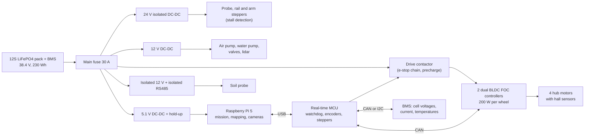

# AgriRover v2: design

v2 is a redesign of [v1](../rover-v1/DESIGN.md) after the team lead's review (2026-10-15). That review raised five problems:
- the probe sat buried in the middle of the machine;
- the rover rode too low for uneven ground and felt unstable;
- the electronics and battery were not designed for the field;
- nothing was said about how long it lasts;
- a person would still have to clean the probe.

v2 starts from the physics instead of from an RC chassis.

Status: **design targets, not built or tested.** Every number comes from [model.mjs](model.mjs). The worked numbers are in [CALCULATIONS.md](CALCULATIONS.md), generated by `node hardware/rover-v2/calc.mjs`. Numbers marked [A] are assumptions or vendor-class figures to confirm on the bench. The drawing is [drawings/rover-v2-views.svg](drawings/rover-v2-views.svg).

## 1. What was wrong with v1

| v1 | Why it is a problem in a real field |
|---|---|
| Probe in a closed well through the middle of the chassis tub | You cannot see or reach it. Mud and water fall into the body next to the battery and motor driver. The cleaning cartridge comes out from underneath, so the rover has to be tipped over to service it. |
| Belly 100 mm, motor pods 56 mm, camera beam 72 mm above the ground | Tomato beds are raised about 10 cm, and the lanes have ruts and 3 to 8 cm clods. A skid-steer that grounds its belly or pods on a clod loses all traction. |
| 150 mm wheels | Climbs only about 38 mm reliably. |
| 6.9 kg total | The probe can push at most 54 N before a wheel lifts. Dry soil needs about 106 N (CALCULATIONS.md), so v1 fails exactly when the field needs watering. |
| Sprung trailing arms | The springs compress when the probe pushes, so the body rises and the push is not repeatable. On a twist, one wheel unloads. |
| Li-ion 3S pack, BMS unspecified | Nickel-rich Li-ion in a hot, dusty field is a fire and lifetime risk, and no protection limits were specified. |
| If cleaning fails twice: "the operator is alerted" | That puts a person back in the loop for every stubborn sample. |

## 2. The physics that sets the layout

### 2.1 Probe force: Newton's third law
Pushing the probe into the soil pushes the rover up with the same force. The push can never exceed the weight holding the rover down, and it is only that large if the push acts at the centre of the supports. So:

- **The probe stays between the axles.** This is the only place where the full weight resists the push. Putting it behind the rear axle (v1 calculated 25 N) or outside the wheels (which would also reach into the plant row) throws most of the weight away. v2 keeps the probe on the line between the axles, but in an **open bay you can see and reach** (Section 3), not inside the machine.
- **Mass is useful when it sits low and over the probe.** The four hub motors (9.6 kg) sit at axle height, and the battery and the controllers are balanced fore and aft of the probe. The centre of mass ends up within a millimetre of the probe axis and 178 mm off the ground.
- **Result:** 176 N usable push, with the probe centred and a 20% safety margin. That is 1.7 x the 106 N dry-crust estimate, against v1's 54 N. With the probe moved 60 mm to one side, 130 N is still usable.

### 2.2 Staying upright: the support polygon
A rover tips when the line straight down from its centre of mass leaves the polygon of wheel contacts. With a 335 mm track, a 300 mm wheelbase and the centre of mass at 178 mm, v2 tolerates a 43 deg side slope and a 40 deg fore-aft slope before tipping (static). It needs 0.84 g of braking to tip forward, and a stop from 0.5 m/s in 0.25 s is 0.2 g. Wider is not possible: the lane between canopies is 0.60 m, and the simulator's clearance check uses the 0.40 m width.

### 2.3 Uneven ground: a rocker-differential, no springs
Each side's two wheels hang from a **rocker beam** that pivots on the body. A **differential bar** across the front box links the two beams, so the body takes the average of their angles.

- A 100 mm clod under one wheel tilts that beam 19 deg, but the body only about 10 deg.
- All four wheels stay loaded, so traction and the probe's push stay even.
- There are no springs, so the body does not rise when the probe pushes. The push and the depth are repeatable.
- The probe axis sits on the pivot line, so its reaction splits equally between the two beams, and each beam shares it between its two wheels.

This is the same mechanism as planetary rovers, minus the third wheel pair. It has fewer parts than four sprung corners and nothing to adjust.

### 2.4 Ground, grip and climbing
- **Wheels:** 216 mm (8.5 in) pneumatic hub-motor wheels, run soft (about 60 kPa) for flotation on tilled soil. Tyres get puncture sealant because fields have stubble and thorns.
- **Ground pressure:** about the same as a person standing.
- **Traction:** about 121 N of pull against 22 N of rolling resistance on soft soil. That handles grades up to about 24 deg and steps of about 54 mm (v1: about 38 mm).
- **Clearance:** 150 mm under the body and 165 mm under the rocker beams, with nothing lower than the tyres. The camera heads ride at 150 mm and only drop to 95 mm under the leaves when deployed.
- **Turning in place:** skid steering works best when the wheelbase is shorter than the track, and v2 is 300 vs 335 mm. Each wheel controller is limited to 200 W, which is more than a turn on soil needs (about 6 N m at 2 rad/s).

## 3. Layout: the open tool bay
The body has a front box (motor controllers, cleaning pump and water tank) and a rear box (battery and BMS), joined by two 3 mm side plates that carry the rocker pivots. Between them is an **open tool bay**, 190 x 210 mm, open below and above.

- **The probe module is one drop-in unit:** a sled on two sideways rails, a sealed drive tower with its stepper beside it (not on top: lower), the cleaning station hanging under the sled, and the probe. The station rides the rail with the probe, so it is under the probe wherever the rail puts it. It is held by two thumb screws, one M12 connector and one push-fit air/water line. A spare can be swapped in a minute, from above, without tools.
- **The cleaning station sits at the floor of the bay,** directly under the parked probe. Scraped soil falls straight back onto the ground, never into the machine.
- **The sideways rail (plus or minus 60 mm) does two jobs.** If the probe hits a stone, it shifts 5 cm and tries again without driving. It can also sample nearer the bed edge, where the roots are, when the soil is moist enough for the lower push off-centre.
- **Wet and dry zones are separated.** Only the bay and the station get muddy. The electronics sit in a sealed enclosure on the rear deck, behind the bay. The battery is in its own sealed box.
- **The probe is pushed by a rigid push chain, not a linear axis.** The probe parks with its tips 210 mm up and must travel 330 mm, through a cleaning station whose top is 205 mm up, and the tower may not be taller than 400 mm (canopy, §9). Any rigid push rod would have to reach below the station at full depth, so parked it would stand about 570 mm tall; telescoping stages above it do not change that. A zip chain does: two strands, coiled side by side in a magazine on the sled beside the tower, run through guides into a zip block at the top of the tower and lock together into a 16 x 12 mm column that pushes the probe. Only that column and the probe pass through the station. The magazine holds 384 mm of each strand for the 330 mm stroke, and the chain, guides and magazine are sealed, because mud and grit are what kill drives. `model.mjs` checks all of this when it loads and refuses a drive that does not fit.

Alternatives considered:
- **Rear-mounted probe:** easy to reach, but about a quarter of the push.
- **Side-mounted probe:** reaches into the plant row and rolls the rover.
- **Front-mounted probe:** blocks the camera beam and lifts the front.

The open middle bay keeps the physics of v1's centre position and fixes its access problem.

## 4. Probe cleaning without a person

**Why it matters:** wet soil left on the rods biases the next reading toward the last spot's moisture (v1 Section 4.4).

The rule for v2 is that **no step needs a person.** Every cycle ends with a check that the probe is clean, and failures escalate automatically:

| Level | When | What happens | Time |
|---|---|---|---|
| 0 | Every cycle, while retracting | A polyurethane **wiper plate** with three rod-shaped slots scrapes the rods, then two strip brushes. Polyurethane squeegees clay off better than bristles. | 0 (part of the retract) |
| 1 | Every cycle | 3 s **air knife**, then the **air check**: the parked probe must read within 0.02 of its clean-air baseline [A]. | 4 s |
| 2 | Air check fails | Stroke down and back through the wipers once more, blast again, check again. | about 8 s |
| 3 | Still failing | **Wet clean:** a 1 s water spray through the same ring (2 mL from a 0.5 L tank), 8 s of air to dry, then the air check. The check proves the water film is gone before the next reading, which is what made water unsafe in v1. | 10 s |
| 4 | Still failing after 2 wet cleans | The reading is marked invalid, and the rover keeps surveying. The simulator's `recheck` strategy already goes back to such spots. If it happens 3 times in a mission, the rover goes to the dock early. | 0 |
| 5 | Every mission end, at the dock | Deep clean: the probe dips into a **wash cup** with a rotating brush, is rinsed, and is air-dried. Then a **reference check**: the probe goes into a block of known permittivity [A] and must read its value within 0.015. This catches drift, rod coating and corrosion. The dock refills the water tank and charges the battery. | about 2 min |

**What a person still does,** on a schedule, never per sample:
- Refill the dock's 10 L water reservoir about every 5 days.
- Swap the wiper plate about every 28 days and the brushes about every 56 days (at 180 probes a day).
- Rinse the pump filter.

The rover logs how often each level is used. A rising share of level 3 cleans warns that the wipers are wearing out, before readings suffer.

**Honest limit:** sticky, wet clay may still beat level 3. Measure the share of cycles reaching each level on the team's real soil before trusting the 10% wet-clean assumption.

## 5. Electronics

Design rules, and why:

- **The probe is galvanically isolated:** an isolated supply and isolated RS485. Its rods sit in wet, salty soil, and any current path from the rover through the soil corrodes the rods by electrolysis and shifts the readings. The probe also never sees a DC offset between its rods and the chassis.
- **Hardware safety does not depend on software:**
  - The e-stop and the RC kill switch open the drive contactor directly.
  - The real-time MCU stops the motors if the Pi's heartbeat is missing for 200 ms.
  - The motor controllers stop if the MCU's CAN messages stop.
- **Shutdown is clean:**
  - The 5 V rail has a hold-up capacitor.
  - The BMS warns the MCU before it cuts power.
  - The Pi gets about 10 s to finish writing its logs.
  - The root file system is read-only, with a separate data partition, so a power cut cannot corrupt the system.
- **Sealing:**
  - The enclosure is IP65.
  - Every external connection is an M12 or M8 IP67 connector, with no cable glands that work loose.
  - A Gore-type membrane vent stops the enclosure pumping in humid air as it heats and cools. That is the main cause of condensation inside sealed boxes.
  - The boards are conformal-coated.
- **Heat:** a dark box in the sun runs 20 to 30 C above the air [A], and the Pi 5 throttles at 80 C. So the enclosure is white, has a sun shield, and has a heat-sink path to the deck.
- **EMC:** motor and stepper power runs separately from the probe and sensor wiring, the ground is a star point at the battery negative, and all three stepper and motor drivers have current limits.

## 6. Battery and BMS

**Chemistry: LiFePO4 (LFP), not nickel-rich Li-ion.**

| | LiFePO4 | NMC Li-ion (v1) |
|---|---|---|
| Thermal runaway | Much harder to trigger; no oxygen release from the cathode | Starts at lower temperatures; burns vigorously |
| Cycle life to 80% capacity | About 2,000+ [A] | About 500 to 1,000 [A] |
| Energy per kg | About 60% of NMC | Higher |
| Charging below 0 C | Not allowed (lithium plating) | Not allowed |

LFP's extra weight sits low and over the probe, so here it helps.

**Pack:** 12S1P of 6 Ah 32700 LFP cells [A]: 38.4 V nominal (30 to 43.8 V), 230 Wh. This gives about **7 surveys per charge**: 26 Wh per seed-7 survey against 184 Wh usable.

**BMS functions and limits:**

| Function | Setting | Why |
|---|---|---|
| Cell over-voltage | 3.65 V cut; charge only to 3.55 V | Stopping a little short of full lowers the stress on the cells and lengthens their life [A] |
| Cell under-voltage | Software stops the mission at 2.9 V; BMS cuts at 2.5 V | Deep discharge damages cells; the gap leaves room to save logs |
| Over-current | 25 A continuous, 50 A for 1 s, short circuit 120 A in 200 us | Peak draw is 21 A with the 200 W motor limits |
| Temperature | 3 NTC sensors (2 cells, 1 MOSFETs). Charge 0 to 45 C only; discharge -20 to 60 C | LFP must not be charged below 0 C |
| Balancing | Passive, 60 mA, at the top of charge when cells differ by more than 30 mV | Keeps the 12 cells matched over years |
| Switching | High-side MOSFETs | Keeps a common ground, so the CAN/I2C link to the MCU survives a BMS cut |
| Precharge | Through a resistor before the contactor closes | The controllers' capacitors would otherwise spark and pit the contactor |
| State of charge | Coulomb counting with a shunt monitor, reset at full charge | LFP's voltage is nearly flat between 20 and 90%, so voltage alone cannot tell the charge |
| State of health | Capacity measured at every full charge; cycle count | Tells the team when the pack nears 80% |
| Return to dock | At 30% charge | Covers the longest drive back plus a margin |
| Storage | Holds 55% charge when parked for weeks | Kindest storage state for lithium cells |
| Charging | At the dock through spring contacts: CC/CV 3 A (0.5 C) to 42.6 V, about 1.4 h from 30% | Contacts are only live when the dock sees the rover's ID resistor |

## 7. Integrity and how long it lasts

| Threat in a field | What v2 does |
|---|---|
| Mud and water | Open bay, so mud falls through. Sealed boxes; IP67 connectors; the probe drive sealed in its tower; sealed (2RS) bearings in the pivots. |
| Dust | IP65 enclosure with a membrane vent; the lidar window is cleaned at the dock. |
| Fertiliser salts and irrigation water | 316 stainless fasteners and probe rods; anodised aluminium; nylon washers between stainless and aluminium to stop galvanic corrosion; conformal-coated boards. |
| Sun (UV and heat) | ASA or UV-stabilised PETG printed parts (never PLA); white enclosure with a sun shield; LFP cells. |
| Dew and cold mornings | No charging below 0 C; the membrane vent; a heater pad on the camera windows [A]. |
| Vibration over clods | No springs to fatigue; thread-locker and wedge-locking washers on the rocker pivots. |
| Software and data | Read-only system, checksummed logs, a watchdog, and an update that rolls back if it fails to boot. |

Wear parts and service intervals are in [CALCULATIONS.md](CALCULATIONS.md#wear-parts-and-service). At 180 probes a day, nothing needs a person more often than weekly.

## 8. What the simulator uses

[configs/scenarios/rover_v2.yaml](../../configs/scenarios/rover_v2.yaml) runs the simulator with v2's footprint (0.40 x 0.58 m) and its probe cycle (29 s average). The seed-7 survey passes the clearance validation, which includes the new tracking allowance, with zero plant contacts and the same map. The mission takes 47 min against 28 min with the old 10 s placeholder; the probe time dominates.

## 9. Open questions to settle on the bench

1. **Real soil strength in the target field,** dry and after irrigation. This decides whether 176 N is enough or whether ballast is needed.
2. **The share of cycles that reach each cleaning level** in the team's soil, and the actual wiper and brush life.
3. **A reference block material** whose permittivity is stable with temperature [A], for the dock check.
4. **Hub-motor controllers:** check the firmware licence before modifying or shipping any of it. Some popular hoverboard firmwares are GPL.
5. **The rocker pivot's stiffness** under the probe push. The body should not tilt more than 1 deg at 176 N.
6. **Tyre pressure** against sinkage in freshly tilled soil.
7. **Along-row positioning** without RTK (unchanged from v1).
8. **Canopy height:** whether the 400 mm probe axis and the 418 mm GNSS antenna clear the lowest leaves in real staked rows.
